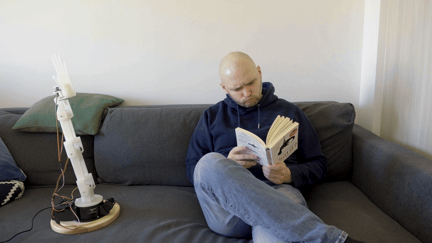
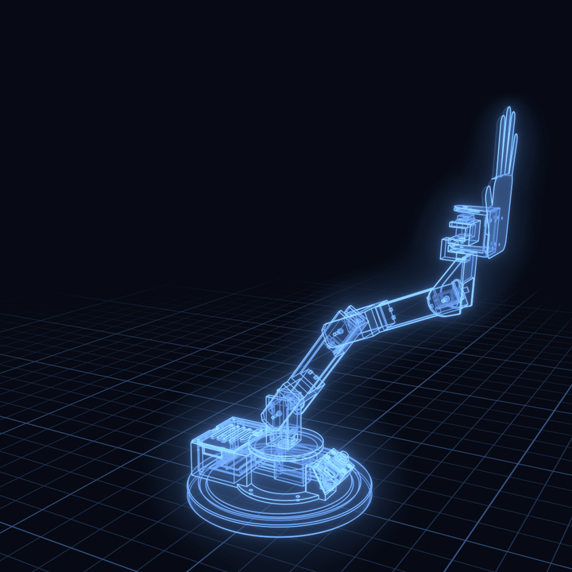

# Greg, the high-five robot



Greg is a 3D-printed robot arm with one job. Hold up an open palm, and he reaches out and gives you a high five.

A camera in his base spots your hand, a small server finds your palm and works out how to reach it, and five servos do the rest. Turn on one power supply and he's ready within seconds.

Andris Gauracs built Greg by hand. [Claude](https://claude.com/claude-code) wrote the parametric CAD, both firmwares and the vision software, in one long Claude Code session. This repo has everything you need to build your own.

**Rough cost:** $140 to $230 in parts, plus a 3D printer. See the [bill of materials](BOM.md).

## How it works

1. The **camera** (XIAO ESP32S3 Sense with a wide lens) streams video over Wi-Fi.
2. The **server** (`tools/highfive.py`, on your computer) finds hands with MediaPipe and checks for an open, raised palm.
3. A **calibrated model** turns the palm's position in the picture into joint angles. A small learned model picks the wrist and twist, so Greg's palm lines up with yours.
4. The **arm** (ESP32-S3 and five servos) strikes about 3 cm past the touching point at full speed, then goes home.



## What's in here

| Folder | Contents |
|---|---|
| [`BOM.md`](BOM.md) | Parts list with rough prices |
| [`stl/`](stl) | Every printable part, already in print orientation |
| [`print/`](print) | Ready-to-slice plates for a 225 × 225 mm bed, with assembly notes for each stage |
| [`cad/`](cad) | The parametric model. Every part is generated from measured constants |
| [`firmware/`](firmware) | `arm_wifi` and `camera_highfive`, plus trim and diagnostic sketches |
| [`tools/`](tools) | The server, calibration, and the jog and voice pages |
| [`calibration/`](calibration) | The original robot's calibration data, as a reference |
| [`docs/WIRING.md`](docs/WIRING.md) | Power board, pin map and camera lead |

## Build it

Build in stages and test each one before moving on. The arm only gets harder to fix as it grows.

### 1. Print the parts

Print the fit tests first. Servo clones vary by about 1 mm, so check yours before starting the big parts. If they don't fit, change `SERVOS` and `CLR` in `cad/highfive_robot.py` and regenerate.

Settings for everything: PLA or PETG, 0.2 mm layers, 3 walls, no supports. Infill is listed per plate. The base alone takes 8 to 10 hours.

| Stage | Parts | Notes |
|---|---|---|
| [1](print/stage1/PRINT.md) | Fit test, base, bay lid, temporary pointer | The pointer lets you test the pan joint before the arm exists |
| [2](print/stage2/PRINT.md) | Shoulder, upper arm, pivot spacers | |
| [3](print/stage3/PRINT.md) | MG90S fit test, forearm | |
| [4](print/stage4/PRINT.md) | Twist bracket, hand mount, hand | |
| [Camera](print/camera_box/PRINT.md) | Wedge, box, lid, lens ring | |

Using another slicer or bed? Use the files in `stl/` instead of the plates. To regenerate them after changing the model, run this from the repo root:

```sh
/Applications/Blender.app/Contents/MacOS/Blender -b --factory-startup --python cad/highfive_robot.py
```

This also writes `cad/highfive_robot.blend`, a posable model of the whole robot. It was tested on Blender 4.3.

### 2. Solder the power board

Follow the [wiring guide](docs/WIRING.md). Read its three rules first. The missing common ground caused more trouble on the original build than anything else.

### 3. Flash the firmware

Install [arduino-cli](https://arduino.github.io/arduino-cli/) and the ESP32 core (tested on 3.3.12):

```sh
arduino-cli core update-index
arduino-cli core install esp32:esp32
```

Add your Wi-Fi details. It must be a 2.4 GHz network.

```sh
cp .env.example .env     # then fill it in
python3 firmware/arm_wifi/make_secrets.py
python3 firmware/camera_highfive/make_secrets.py
```

This writes `wifi_secrets.h` files, which are ignored by git. Build output contains your password too, so don't share it.

Find each board's port with `arduino-cli board list`, then flash. **Remove the JP1 jumper before you plug the arm board into USB, and pull the CAM plug before you plug in the camera.**

```sh
# Arm board, through its UART USB port
arduino-cli compile -u -p <port> --fqbn esp32:esp32:esp32s3:FlashSize=16M,PSRAM=opi firmware/arm_wifi

# Camera
arduino-cli compile -u -p <port> --fqbn esp32:esp32:XIAO_ESP32S3:PSRAM=opi firmware/camera_highfive
```

The arm board's RGB LED shows how far it got: red (starting), yellow (servos on), blue (joining Wi-Fi), green (online). The boards then appear on your network as `highfive-arm.local` and `highfive-cam.local`.

### 4. Set up the server

Tested on macOS with Python 3.12:

```sh
python3 -m venv .venv
.venv/bin/pip install -r requirements.txt
mkdir -p models
curl -L -o models/hand_landmarker.task https://storage.googleapis.com/mediapipe-models/hand_landmarker/hand_landmarker/float16/latest/hand_landmarker.task
```

Check that the arm answers:

```sh
.venv/bin/python tools/arm.py "?"          # print the state
.venv/bin/python tools/arm.py "J 0 1500"   # move joint 0 (pan) to 1500 µs
```

### 5. Assemble

Work through the stages, following each `PRINT.md`. Centre each servo before fitting its horn, and test each joint before adding the next.

Joints are numbered 0 pan, 1 shoulder, 2 elbow, 3 wrist, 4 twist. Screw the base to the wooden board before the arm gets long, because a fast slap will tip it otherwise.

### 6. Trim the joints

Your servos and horns won't line up exactly like the original's.

1. Flash `firmware/joint_cal5` and open a serial monitor at 115200. Use `p s e w t` to pick a joint and `+ -` to nudge it until it's straight.
2. Copy the printed offsets into `JOINT_TRIM_US` in `firmware/robot_config.h`, then copy that file over `firmware/arm_wifi/robot_config.h`.
3. Flash `arm_wifi` again.
4. Run `.venv/bin/python tools/arm_jog.py`, open <http://localhost:8090>, pose the arm at rest and press **Save holding joints as home**. This writes `HOME_US` into the `robot_config.h` files. Flash `arm_wifi` once more to apply it.

### 7. Calibrate the camera

This teaches Greg where his hand appears in the picture. **The model in this repo fits the original robot only, so you need to do this for yours.**

1. Stick a red cardboard label on the underside of the hand.
2. Point a bright light up at it from below, and turn off anything that adds clutter overhead. A white hand against a white ceiling doesn't work, which is why the label is red.
3. Run the calibration. The arm steps through about 268 poses, and needs clear space around it.

   ```sh
   .venv/bin/python tools/cam_calib.py --v5 --red --all
   .venv/bin/python tools/cam_fit.py calibration/calib_v5redall.json
   ```

4. Paste the printed `TERMS`, `AX` and `AY` into `tools/cam_model.py`, and update `REACH` with the range your arm really covers. `calibration/calib_sheet*.jpg` shows every detection, so you can see what worked.

Expect a leave-one-out error of around 5 px. Much higher usually means bad detections, so check the sheet.

### 8. Teach it your high five

The wrist and twist are learned from examples. Start the server and the voice page together:

```sh
.venv/bin/python tools/highfive.py
.venv/bin/python tools/arm_jog.py
```

1. On <http://localhost:8091>, turn on **HOLD mode** and hold up your palm. Greg reaches it and stays there.
2. On <http://localhost:8090/voice> (use Chrome, for speech recognition), correct his hand out loud: "towards me", "away", "left", "right", "closer", "further", "a bit", "a lot".
3. Say "that's it" to save the example to `calibration/wrist_pairs.jsonl`.
4. Repeat at different heights and angles. About 15 examples worked well.

Check the fit with `.venv/bin/python tools/posture.py`.

### 9. High five

```sh
.venv/bin/python tools/highfive.py
```

Open <http://localhost:8091>, press **ARM ON**, and hold up an open palm inside the green zone. The page also has sliders for reaction delay, speed and slap depth, so you can tune him without reflashing.

To have Greg start by himself on a Mac:

```sh
tools/service/install.sh            # add --remove to uninstall
```

The server then starts at login with the arm on. Its log is at `~/Library/Logs/highfive.log`.

## Troubleshooting

| Symptom | Likely cause |
|---|---|
| Servos jitter, tremble or follow each other | Missing common ground. Check the GND link to the arm board first |
| A joint copies another joint | Run `firmware/pin_pulse_probe` to see whether it's wiring or firmware. Don't use the ESP32Servo library on this chip: it gave the third servo the first one's channel, so this firmware sets LEDC channels explicitly |
| Arm runs on USB but not on the DC supply | Check the LED colour, then read the boot log over USB with the `B` command |
| Camera doesn't appear after power-up | The firmware retries by itself, so give it a minute. Check that the network is 2.4 GHz and the antenna is seated |
| Black dots in the picture | Reseat the camera ribbon |
| Video is slow | The original's link was weak, at 1 to 3 fps. Check the antenna's seating and position |
| Twist no longer centres | The horn has slipped after many slaps. Refit it and tighten the screw |
| Greg ignores your palm | Check that it's inside the green zone, then adjust `MIN_PALM` and `MAX_PALM` in `tools/highfive.py` |
| `.local` names don't resolve | Set `ARM_HOST=<ip>` for the arm, and pass the camera's IP: `tools/highfive.py <ip>`. On Linux, install Avahi |

## Good to know

- **Greg hits hard.** It's a plastic hand on fast servos, so keep faces out of reach and test at low speed first.
- **Tested on one robot.** This was built once, on a Mac. You'll probably need to adjust clearances for your printer and servos.
- **Print clearances matter.** Tilted holes sag when printed, so allow extra there. A fit test only counts if it's printed in the same orientation as the real part.
- **Model real parts.** Many early problems came from designing around bare servo bodies and forgetting their cables.

## License

[MIT](LICENSE). `firmware/camera_highfive` is based on Espressif's CameraWebServer example and keeps its Apache 2.0 headers.
