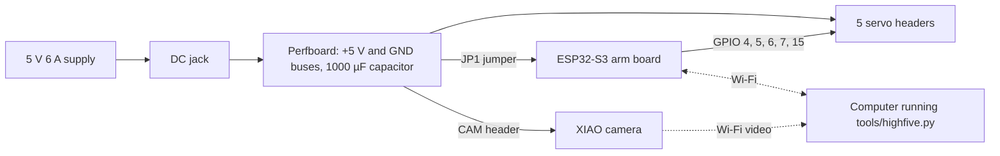
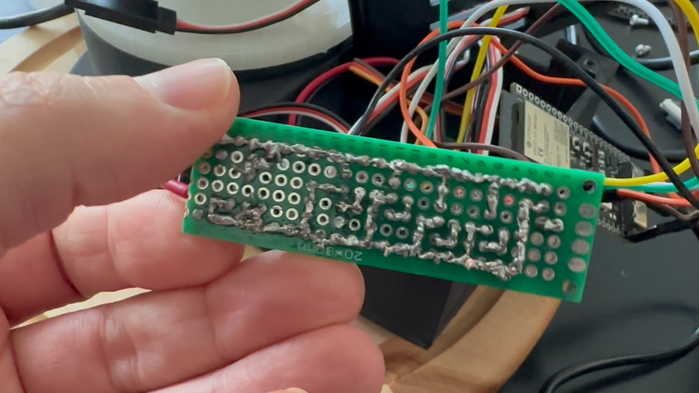
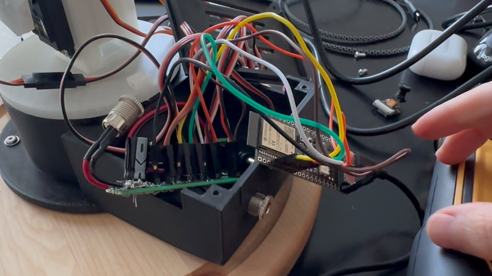

# Wiring

Everything runs from one 5 V supply. A small perfboard in the electronics bay splits that supply between the five servos and both boards.

## Three rules

1. **Connect every ground together.** Without a common ground the servos jitter, tremble or copy each other. This was the most repeated fault on the original build.
2. **One 5 V source per board at a time.** Pull the JP1 jumper while the arm board is on USB, and pull the CAM plug while the camera is on USB. Otherwise the supply and your computer's USB port fight over the same line.
3. **Never power a servo from a board's 5 V pin.** One MG995 can pull more than 1 A when it starts moving. Servos always take power from the bus.

## Perfboard

Two bare tinned wires run along the board as buses, one for +5 V and one for GND. Each header straddles them, with − on the GND bus and + on the 5 V bus. That matches a servo plug's brown, red, orange order, so a plug can't go in one pin off.

| From | To | Wire | Notes |
|---|---|---|---|
| DC jack centre pin | +5 V bus | 20 AWG red | Check with a multimeter that the centre pin is positive |
| DC jack sleeve | GND bus | 20 AWG black | Heat-shrink both lugs, and strain-relieve the leads with a zip tie |
| Capacitor + | +5 V bus | own leg | The striped leg goes to the GND bus |
| GND bus | Arm board GND | 22 AWG black | Always connected, even on USB |
| +5 V bus through JP1 | Arm board 5V | 22 AWG red | Remove JP1 while the board is on USB |
| GPIO 4 | PAN header, signal | 22–26 AWG | MG995 |
| GPIO 5 | SHOULDER header, signal | 22–26 AWG | MG995 |
| GPIO 6 | ELBOW header, signal | 22–26 AWG | MG995 |
| GPIO 7 | WRIST header, signal | 22–26 AWG | MG90S |
| GPIO 15 | TWIST header, signal | 22–30 AWG | MG90S |
| CAM header | XIAO VUSB and GND | 2-wire lead | See below |

Pin positions vary between dev boards, so go by the labels printed on yours. GPIO 48 is the board's RGB status LED.

Stand the perfboard on 5 mm standoffs, so the servo and camera cables can pass underneath.

## Before you plug anything in

With no boards or servos connected, power up and measure a servo header. + to − should read 5.0 V, not −5.0 V.

## Camera power lead

One 2-wire lead takes 5 V from the CAM header to the XIAO. It runs under the perfboard, out through the bay's front wall, along the hidden channel in the base, and into the camera box's floor slot. The camera draws about 0.3 A, so 22–24 AWG is plenty.

1. Cut a 2-wire female dupont lead about 5 cm longer than the route. Keep the plug on the CAM end and strip the other end about 3 mm.
2. Plug it onto the CAM header, power up and measure red to black. It must read +5.0 V. Then unplug everything.
3. Thread the bare ends through the floor slot, the riser and the hidden channel.
4. On the XIAO's flat side, with the USB-C end pointing away from you, 5V is the top hole of the left column, labelled VUSB. GND is the one just below it. Solder red to VUSB and black to GND, keeping the joints low and flat.
5. Check that no solder bridges GND to 3V3, the next hole along.
6. Unplug the camera's USB-C before you plug in the CAM lead.

## Routing the arm cables

Pan's cable runs through the tunnel in the floor of the base. The others come down the arm, through the slot in the bay lid, and into their headers. Leave slack at every moving joint: about 8–10 cm of loose cable across the pan joint, and about 3 cm at the wrist. Each stage's `PRINT.md` has the exact route.
